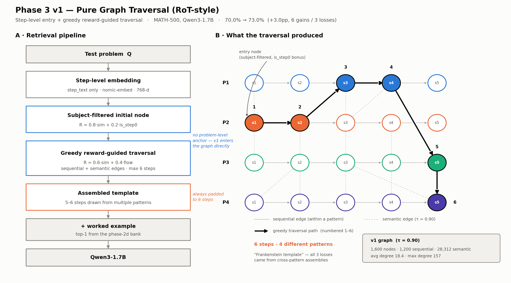
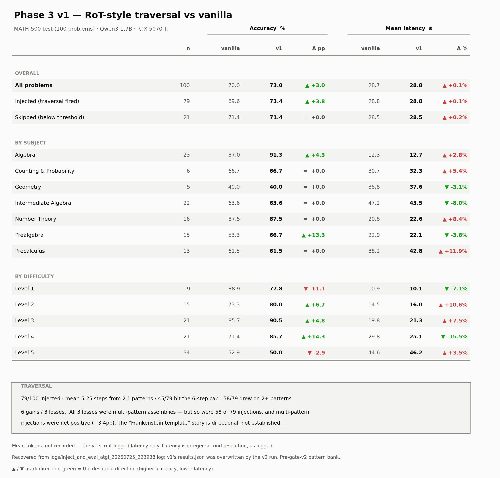

# Phase 3 v1 — Pure Graph Traversal (RoT-style)

> The first phase-3 attempt: embed the query at **step level**, enter the thought graph
> directly, and assemble a template by greedy traversal across patterns. Superseded by
> [v2](Readme_v2.md); kept as the RoT baseline.

**Result: 70.0% → 73.0% (+3.0pp)** on MATH-500 test (100 problems), Qwen3-1.7B, RTX 5070 Ti.
6 gains / 3 losses. Latency flat (+0.1%). Tokens not logged.

> ⚠️ **Read [Provenance](#provenance) before citing.** v1's code and per-problem results were
> overwritten by v2. Everything below is recovered from the run log.

---

## Architecture



*Regenerate:* `python3 results/plot_v1_architecture.py`

| Stage | What happens |
|---|---|
| 1. Embed | Query embedded at **step level** (`step_text` only, nomic-embed, 768-d) — no problem-level anchor |
| 2. Entry node | Subject-filtered initial node, scored `R = 0.8·sim + 0.2·is_step0` |
| 3. Traversal | Greedy reward-guided walk, `R = 0.6·sim + 0.4·flow`, over sequential **and** semantic edges, capped at 6 steps |
| 4. Assemble | Template built from whatever steps the walk visited — potentially several patterns |
| 5. Ground | Append top-1 worked example from the phase-2d bank |
| 6. Generate | Qwen3-1.7B |

**Hyperparameters** (as logged): `α=0.8, β=0.6, τ_stop=0.4, max_steps=6`, graph `τ_semantic=0.90`.
Both scoring functions are spelled out in [Scoring formulas](#scoring-formulas).

### Graph (v1)

Step embeddings are the **bare step text**, which is what makes them undiscriminating.

| Metric | v1 | (v2 for contrast) |
|---|---|---|
| Nodes | 1,600 | 1,600 |
| Sequential edges | 1,200 | 1,200 |
| Semantic edges | 28,312 | 2,830 |
| Avg degree | 18.4 | 2.5 |
| Max degree | 157 | 27 |
| Same-subject pairs | 4,808 | 1,037 |
| Cross-subject pairs | 9,348 | 378 |

---

## Scoring formulas

Both are weighted sums of a **relevance** term (similarity to the query) and a **structure**
term (position in a reasoning chain). Source: `todo_phase3_atgi.txt` lines 61–95 and 205–210
— the design spec, which survived even though the code did not.

### 1. Entry node

```
R_initial = α · sim(Q, node) + (1 − α) · is_first_step        α = 0.8
```

| Term | Range | Meaning |
|---|---|---|
| `sim(Q, node)` | 0–1 | Cosine similarity between query and step node |
| `is_first_step` | 0 or 1 | **1.0** if `step_index == 0`, else **0.0** — a flat bonus for chain openers |
| `α = 0.8` | — | Weights relevance 4:1 over structure |

Candidates are pre-filtered to Q's subject. Worked example:

| Candidate | sim | `is_first_step` | R_initial |
|---|---|---|---|
| A — Step 1 of some pattern | 0.55 | 1.0 | 0.8(0.55) + 0.2(1.0) = **0.64** |
| B — Step 3, more relevant | 0.70 | 0.0 | 0.8(0.70) + 0.2(0.0) = **0.56** |

A wins despite 0.15 less similarity. The bonus is worth `0.2 ÷ 0.8 = 0.25` of raw sim, so a
mid-chain node must beat a first step by **>0.25 sim** to become the entry point.

The winner is then checked against the phase-2d per-subject threshold (IA 0.60, NT 0.65,
Precalc 0.65, Geom 0.55, default 0.50) on its **raw sim**, not on `R_initial`. Below it,
injection is skipped and the vanilla prompt is sent.

### 2. Each traversal hop

```
R_traverse = β · sim(Q, neighbor) + (1 − β) · R_flow          β = 0.6

R_flow = 1.0   sequential successor (next step, same pattern)
         0.5   semantic edge (different pattern)
         0.0   otherwise
```

`R_flow` is structural continuity: staying inside a pattern's own step order is worth double
a jump to another pattern. Worked example:

| Neighbour | sim | `R_flow` | R_traverse |
|---|---|---|---|
| Next step, same pattern | 0.50 | 1.0 | 0.6(0.50) + 0.4(1.0) = **0.70** |
| Step from another pattern | 0.70 | 0.5 | 0.6(0.70) + 0.4(0.5) = **0.62** |

Greedy `argmax` → append → repeat.

**Termination** (any one triggers): `max(R_traverse) < τ_stop = 0.40`; `len(T) ≥ max_steps = 6`;
or no valid neighbours remain. Near-duplicate steps (sim > 0.95) are then collapsed, keeping
the higher-scoring one.

### What the weights actually imply

**The sequential bias is worth 0.333 sim.** A sequential neighbour gains +0.4 from flow, a
semantic one +0.2 — a flat 0.2 advantage. Overcoming it requires `0.2 ÷ 0.6 = 0.333` more
similarity. With v1 step similarities clustering near 0.55, the walk should almost never leave
its pattern.

**Yet 58 of 79 templates were multi-pattern** — because patterns only have **4 steps**. Once
the walk consumes them, `R_flow = 1.0` is off the menu and only semantic jumps remain. The run
log confirms it exactly:

| Template length | 1 pattern | 2 patterns | 3 patterns |
|---|---|---|---|
| 3 steps | 3 | — | — |
| 4 steps | 18 | 1 | — |
| 5 steps | — | 7 | 5 |
| 6 steps | — | 21 | 24 |

**No template longer than 4 steps is single-pattern.** `max_steps = 6` against 4-step patterns
*mechanically forces* cross-pattern assembly on every template that runs past step 4 — 57 of
79. So "always padded toward 6 steps" and "Frankenstein templates" are not two independent
failures: the cap causes the mixing. Setting `max_steps = 4` would have eliminated
cross-pattern assembly without touching α or β.

**`τ_stop = 0.40` was nearly inert.** With β = 0.6, any neighbour reachable by a sequential
edge scores ≥ 0.4 from the flow term alone, so the threshold could only ever fire on a
semantic hop with sim < 0.333.

### Spec vs. implementation

| Parameter | Spec (`todo_phase3_atgi.txt:207`) | Shipped |
|---|---|---|
| `τ_semantic` | 0.80 | **0.90** (`num_semantic: 28,312` at `tau_semantic: 0.9`) |
| α, β, τ_stop, max_steps | 0.8 / 0.6 / 0.40 / 6 | same (confirmed in the run-log header) |

v1's graph builder is also overwritten, so whether the τ change was a deliberate retune or
drift cannot be determined from what is on disk.

---

## Results



*Regenerate:* `python3 results/plot_v1_results_table.py`

### Overall

| Slice | n | Vanilla | v1 | Delta | Van. latency | v1 latency | Delta |
|---|---|---|---|---|---|---|---|
| **All problems** | 100 | 70.0% | **73.0%** | **+3.0pp** | 28.7s | 28.8s | +0.1% |
| Injected (traversal fired) | 79 | 69.6% | 73.4% | +3.8pp | 28.8s | 28.8s | +0.1% |
| Skipped (below threshold) | 21 | 71.4% | 71.4% | +0.0pp | 28.5s | 28.5s | +0.2% |

**Mean tokens: not recorded** — the v1 script logged latency only. Latency is
integer-second resolution, as logged.

### By subject

| Subject | n | Vanilla | v1 | Delta | Van. latency | v1 latency | Delta |
|---|---|---|---|---|---|---|---|
| Algebra | 23 | 87.0% | 91.3% | +4.3pp | 12.3s | 12.7s | +2.8% |
| Counting & Probability | 6 | 66.7% | 66.7% | +0.0pp | 30.7s | 32.3s | +5.4% |
| Geometry | 5 | 40.0% | 40.0% | +0.0pp | 38.8s | 37.6s | -3.1% |
| Intermediate Algebra | 22 | 63.6% | 63.6% | +0.0pp | 47.2s | 43.5s | -8.0% |
| Number Theory | 16 | 87.5% | 87.5% | +0.0pp | 20.8s | 22.6s | +8.4% |
| **Prealgebra** | 15 | 53.3% | **66.7%** | **+13.3pp** | 22.9s | 22.1s | -3.8% |
| Precalculus | 13 | 61.5% | 61.5% | +0.0pp | 38.2s | 42.8s | +11.9% |

### By difficulty

| Level | n | Vanilla | v1 | Delta | Van. latency | v1 latency | Delta |
|---|---|---|---|---|---|---|---|
| L1 | 9 | 88.9% | 77.8% | **-11.1pp** | 10.9s | 10.1s | -7.1% |
| L2 | 15 | 73.3% | 80.0% | +6.7pp | 14.5s | 16.0s | +10.6% |
| L3 | 21 | 85.7% | 90.5% | +4.8pp | 19.8s | 21.3s | +7.5% |
| **L4** | 21 | 71.4% | **85.7%** | **+14.3pp** | 29.8s | 25.1s | -15.5% |
| L5 | 34 | 52.9% | 50.0% | -2.9pp | 44.6s | 46.2s | +3.5% |

Prealgebra (+13.3pp) and L4 (+14.3pp) carry almost the entire gain. L1 regresses −11.1pp,
the same easy-problem penalty every injection method in this project shows.

### Traversal behaviour

| Metric | Value |
|---|---|
| Injected | 79 / 100 |
| Mean template length | 5.25 steps |
| Mean patterns per template | 2.1 |
| Hit the 6-step cap | 45 / 79 |
| Drew on 2+ patterns | 58 / 79 |

| Template composition | n | Vanilla | v1 | Delta |
|---|---|---|---|---|
| 1 pattern | 21 | 57.1% | 61.9% | +4.8pp |
| 2+ patterns | 58 | 74.1% | 77.6% | +3.4pp |

---

## Why it underperformed

Against v2's +6.0pp on the identical eval set:

1. **Step embeddings are too generic.** "Identify the equation" matches hundreds of problems;
   mean anchor similarity ~0.55 vs v2's 0.65. v2 fixes this by embedding
   `"{problem_summary} | {step_text}"`, which cuts semantic edges 10×.
2. **No problem-level anchor.** Entering the graph at step level throws away the discriminative
   power of the whole problem statement.
3. **`max_steps = 6` against 4-step patterns.** 45/79 templates hit the cap, and — as derived
   in [Scoring formulas](#what-the-weights-actually-imply) — *every* template past step 4 is
   forced to cross patterns, because the anchor pattern has no step 5 to walk to. The extra
   steps are noise for a 1.7B student, and the cross-pattern mixing is a side effect of the
   cap rather than of the reward weights.
4. **Flat cost.** Latency +0.1% — v1 paid full inference price for half of v2's accuracy gain.
   v2 cut latency 5.8% *and* doubled the gain.

Note that items 2 and 3 are the cheap fixes: v2 addressed only #1 and #2 and reached +6.0pp.
`max_steps = 4` was never tried.

### ⚠️ The "Frankenstein template" claim is not established

The original write-up said *"all 3 losses came from cross-pattern assemblies."* That is
literally true — all 3 losses had `npat = 2` — but it is **not evidence**:

- 58 of 79 injections (73%) were multi-pattern, so 3/3 is roughly what chance predicts
- multi-pattern injections were net **positive**: 74.1% → 77.6% (+3.4pp)
- single-pattern injections: +4.8pp on n=21 — better, but on a quarter of the sample

Cross-pattern assembly remains a *plausible* failure mode, and the mechanism is intuitive.
It has not been demonstrated. Do not cite it as a finding.

---

## Provenance

v1 and v2 were developed in the same directory and **v2 overwrote v1's artifacts**:

| Artifact | Status |
|---|---|
| Eval script | Overwritten. No code on disk, no separate commit — `inject_and_eval_atgi.py` is v2 |
| Graph | Overwritten. `graph/thought_graph.json` is `v2-context-enriched` (2,830 semantic edges) |
| Per-problem results | Overwritten. `results/results.json` is the v2 run |
| Token counts | Never logged by the v1 script |

Everything in this document is parsed from
**`logs/inject_and_eval_atgi_20260725_223938.log`** by
`results/plot_v1_results_table.py`. That log reproduces 70.0% → 73.0% with 6 gains / 3
losses, which is what identifies it as the run the results tables cite.

### Two v1 runs disagree on injection rate

| Log | Injected | Gains / losses | Net |
|---|---|---|---|
| `..._20260725_192034.log` | 32 / 100 | 4 / 1 | +3.0pp |
| `..._20260725_223938.log` ← cited | 79 / 100 | 6 / 3 | +3.0pp |

Same config, same graph (28,312 semantic edges), same hyperparameters — but a 2.5× difference
in how often traversal fired. Both land on +3.0pp net. **Unresolved.** Worth explaining
before v1 is used as a thesis baseline.

### Reproducing v1 properly

The graph is rebuildable — run `build_thought_graph.py` against `phase-2d/memory/bank.json`
with the embedding text set back to bare `step_text` instead of the context-enriched form.
The eval script would have to be rewritten from the description above. Both need a GPU slot
and the embed model.

All phase-3 numbers predate the **gate-v2 pattern bank** (phase-6) and are not directly
comparable to phase-6 results.

---

## See also

- [Readme.md](Readme.md) — phase-3 overview and cross-phase comparison
- [Readme_v2.md](Readme_v2.md) — the anchor-first successor (+6.0pp)
- **RoT**: Ahmed et al., "Retrieval-of-Thought: Efficient Reasoning via Reusing Thoughts",
  ICLR 2026. [arXiv:2509.21743](https://arxiv.org/abs/2509.21743)
