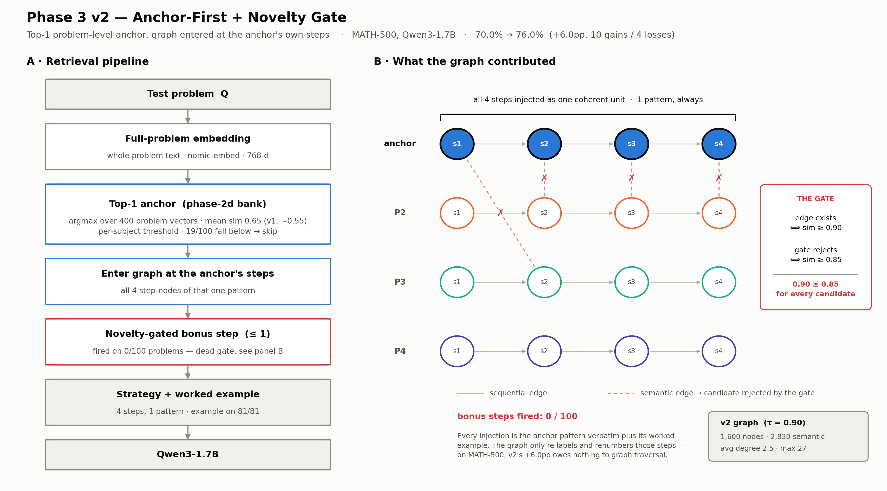
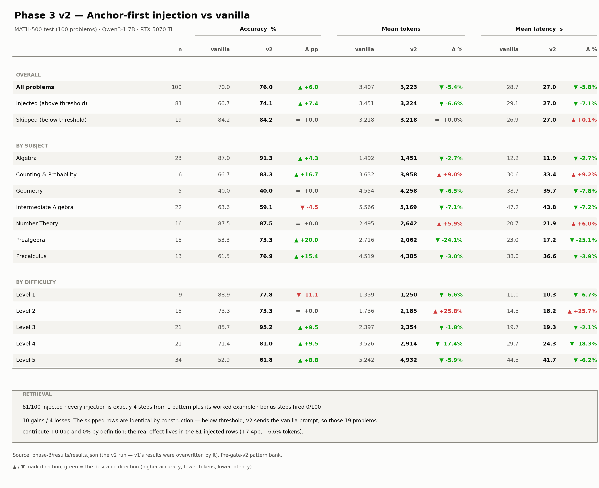

# Phase 3 v2 — Anchor-First + Novelty Gate

> The rewrite of [v1](Readme_v1.md): retrieve a **top-1 problem-level anchor** first, then
> enter the thought graph at that anchor's own step nodes, optionally adding one
> novelty-gated bonus step. This is the architecture phases 3b, 3c, 3d, 4 and 6 inherit.

**Result: 70.0% → 76.0% (+6.0pp)** on MATH-500 test (100 problems), Qwen3-1.7B, RTX 5070 Ti.
10 gains / 4 losses, with **−5.4% tokens** and **−5.8% latency**.

> ⚠️ **The graph contributed nothing to that +6.0pp.** The novelty gate is dead by
> construction — see [The novelty gate never fired](#the-novelty-gate-never-fired).

---

## Architecture



*Regenerate:* `python3 results/plot_v2_architecture.py`

| Stage | What happens |
|---|---|
| 1. Embed | **Whole problem text** embedded (nomic-embed, 768-d) |
| 2. Anchor | `argmax` over the 400-vector phase-2d bank → top-1 pattern. Mean sim **0.65** (v1: ~0.55) |
| 3. Threshold | Per-subject cutoff; below it the vanilla prompt is sent instead. 19/100 skipped |
| 4. Enter graph | Locate that one pattern's 4 step-nodes, ordered by `step_index` |
| 5. Expand | Novelty-gated bonus step, max 1 — **fired 0/100 times** |
| 6. Prompt | Assembled strategy + the anchor's worked example (81/81 injected cases) |
| 7. Generate | Qwen3-1.7B |

### Per-subject thresholds

Carried over from phase-2d: IA = 0.60, Number Theory = 0.65, Precalculus = 0.65,
Geometry = 0.55, default = 0.50.

### Graph (v2)

Each step is embedded as `"{problem_summary} | {step_text}"` rather than bare step text. This
gives step embeddings the discriminative power of full-problem embeddings while keeping
step-level granularity — and it makes semantic edges **10× more selective** than v1's.

| Metric | v1 | v2 |
|---|---|---|
| Nodes | 1,600 | 1,600 |
| Sequential edges | 1,200 | 1,200 |
| Semantic edges | 28,312 | **2,830** |
| Avg degree | 18.4 | **2.5** |
| Max degree | 157 | **27** |
| Same-subject pairs | 4,808 | 1,037 |
| Cross-subject pairs | 9,348 | **378** |
| Isolated nodes | — | 266 |

---

## Scoring formulas

Read off the implementation (`inject_and_eval_atgi.py`), not a spec — unlike
[v1](Readme_v1.md#scoring-formulas), v2's code survives.

**v2 has almost no formulas.** v1's two weighted sums are gone; every scoring decision is a
plain cosine similarity compared against a constant. All embeddings are L2-normalised, so a
dot product *is* cosine similarity.

### 1. Anchor retrieval — no weighting at all

```python
scores = (bank_vectors @ query_vec).flatten()
best   = int(np.argmax(scores))
```

No structural term, no tie-break, no `is_first_step` bonus. The most similar problem in the
bank wins, full stop. Mean winning score: **0.65** (v1's step-level entry: ~0.55).

### 2. Threshold gate

```
inject  ⟺  sim(Q, anchor) ≥ threshold(subject)
```

Per-subject constants carried from phase-2d (IA 0.60, NT 0.65, Precalc 0.65, Geom 0.55,
default 0.50). Below it the vanilla prompt is sent — 19/100 problems.

### 3. Edge construction (`build_thought_graph.py`)

```python
sim      = embeddings @ embeddings.T
sim_norm = (sim + 1.0) / 2.0
edge  if  sim_norm[i, j] ≥ τ = 0.90  and  pattern_i ≠ pattern_j
```

`(x + 1) / 2` rescales cosine from [−1, 1] onto [0, 1].

### 4. Novelty gate

```python
sims_to_anchor    = anchor_embeds @ dst_embed
max_sim_to_anchor = (np.max(sims_to_anchor) + 1.0) / 2.0
if max_sim_to_anchor >= NOVELTY_THRESHOLD:   # 0.85
    continue                                  # reject
```

Take the candidate's similarity to **every** anchor step, keep the **maximum**, rescale,
reject at ≥ 0.85. Read as: *"must be unlike all four steps we already have."*

### 5. Ranking the survivors

```python
query_sim = float(dst_embed @ query_vec)
candidates.sort(key=lambda c: c["query_sim"], reverse=True)
bonus = candidates[:MAX_BONUS_STEPS]          # 1
```

Most query-relevant survivor wins. Note this uses **raw** cosine while step 4 used the
**rescaled** value.

### The scale mismatch is what kills the gate

Both graph thresholds are stated on the rescaled [0, 1] scale. Converting back to raw cosine
(`raw = 2·norm − 1`) makes the failure obvious:

| Threshold | Rescaled | Raw cosine |
|---|---|---|
| Edge exists (`τ_semantic`) | ≥ 0.90 | **≥ 0.80** |
| Gate rejects (`NOVELTY_THRESHOLD`) | ≥ 0.85 | **≥ 0.70** |

A candidate is reachable only *through* an edge, so its similarity to at least one anchor step
is already ≥ 0.80 raw — and the gate rejects everything ≥ 0.70 raw. Since 0.80 > 0.70,
**every candidate is rejected before it is ever ranked**, and `find_novel_bonus_steps` returns
`[]` on all 100 problems. See [The novelty gate never fired](#the-novelty-gate-never-fired).

⚠️ **Mixed-scale hazard.** The per-subject anchor thresholds (0.50–0.65) are **raw** cosine,
while `τ_semantic` and `NOVELTY_THRESHOLD` are **rescaled**. Nothing in the config marks which
is which, so the two families of constants look directly comparable and are not. Any retune
must state the scale.

### Dead config

```python
BETA_TRAVERSE = 0.6    # traversal scoring: semantic vs flow
```

Declared at `inject_and_eval_atgi.py:74` and **referenced nowhere else in the file**. It is
v1's β, left behind when the script was rewritten in place. v2 has no traversal for it to
weight. Delete it — as written it implies a reward function that does not exist.

---

## Results



*Regenerate:* `python3 results/plot_v2_results_table.py`

### Overall

| Slice | n | Vanilla | v2 | Delta | Van. tok | v2 tok | Delta | Van. lat | v2 lat | Delta |
|---|---|---|---|---|---|---|---|---|---|---|
| **All problems** | 100 | 70.0% | **76.0%** | **+6.0pp** | 3,407 | 3,223 | -5.4% | 28.7s | 27.0s | -5.8% |
| Injected | 81 | 66.7% | **74.1%** | **+7.4pp** | 3,451 | 3,224 | -6.6% | 29.1s | 27.0s | -7.1% |
| Skipped | 19 | 84.2% | 84.2% | +0.0pp | 3,218 | 3,218 | +0.0% | 26.9s | 27.0s | +0.1% |

The skipped slice is identical **by construction** — below threshold v2 sends the vanilla
prompt, so greedy decoding reproduces the same output. Its exact 0.0% token delta is a useful
harness sanity check. **The real effect lives in the 81 injected rows: +7.4pp.**

### By subject

| Subject | n | Vanilla | v2 | Delta | Van. tok | v2 tok | Delta | Van. lat | v2 lat | Delta |
|---|---|---|---|---|---|---|---|---|---|---|
| **Prealgebra** | 15 | 53.3% | **73.3%** | **+20.0pp** | 2,716 | 2,062 | -24.1% | 23.0s | 17.2s | -25.1% |
| **C&P** | 6 | 66.7% | **83.3%** | **+16.7pp** | 3,632 | 3,958 | +9.0% | 30.6s | 33.4s | +9.2% |
| **Precalculus** | 13 | 61.5% | **76.9%** | **+15.4pp** | 4,519 | 4,385 | -3.0% | 38.0s | 36.6s | -3.9% |
| Algebra | 23 | 87.0% | 91.3% | +4.3pp | 1,492 | 1,451 | -2.7% | 12.2s | 11.9s | -2.7% |
| Number Theory | 16 | 87.5% | 87.5% | +0.0pp | 2,495 | 2,642 | +5.9% | 20.7s | 21.9s | +6.0% |
| Geometry | 5 | 40.0% | 40.0% | +0.0pp | 4,554 | 4,258 | -6.5% | 38.7s | 35.7s | -7.8% |
| Intermediate Algebra | 22 | 63.6% | 59.1% | **-4.5pp** | 5,566 | 5,169 | -7.1% | 47.2s | 43.8s | -7.2% |

### By difficulty

| Level | n | Vanilla | v2 | Delta | Van. tok | v2 tok | Delta | Van. lat | v2 lat | Delta |
|---|---|---|---|---|---|---|---|---|---|---|
| L1 | 9 | 88.9% | 77.8% | **-11.1pp** | 1,339 | 1,250 | -6.6% | 11.0s | 10.3s | -6.7% |
| L2 | 15 | 73.3% | 73.3% | +0.0pp | 1,736 | 2,185 | **+25.8%** | 14.5s | 18.2s | +25.7% |
| **L3** | 21 | 85.7% | **95.2%** | **+9.5pp** | 2,397 | 2,354 | -1.8% | 19.7s | 19.3s | -2.1% |
| **L4** | 21 | 71.4% | **81.0%** | **+9.5pp** | 3,526 | 2,914 | -17.4% | 29.7s | 24.3s | -18.3% |
| **L5** | 34 | 52.9% | **61.8%** | **+8.8pp** | 5,242 | 4,932 | -5.9% | 44.5s | 41.7s | -6.2% |

**Accuracy and cost move together.** Every subject that gained accuracy also spent fewer
tokens (Prealgebra +20.0pp / −24.1%, L4 +9.5pp / −17.4%). This is the same coupling phase-3e
later identified as the main mechanism: a strategy that reaches the answer sooner both saves
tokens and avoids truncation failures.

L2 is the counter-example: +25.8% tokens for +0.0pp — the one slice where injection made the
model work harder for nothing. Small n (15).

### Injection vs skip

81/100 injected, **19 skipped** (identical to phase-2d):

| Subject | Skipped | Threshold | Note |
|---|---|---|---|
| Number Theory | 12 | 0.65 | Specialised topics, strictest threshold |
| Intermediate Algebra | 3 | 0.60 | Below threshold |
| Prealgebra | 2 | 0.50 | Very low similarity |
| Precalculus | 2 | 0.65 | Strictest threshold |

Number Theory dominates skips (12/19) — NT problems are highly specialised (divisibility,
modular arithmetic), so the closest bank pattern often doesn't clear the 0.65 bar.

---

## The novelty gate never fired

`results/results.json` records `bonus_steps == 0` and `n_unique_patterns == 1` for **all 100**
problems. Every injection was the anchor pattern verbatim (4 steps, 1 pattern) plus its
worked example.

This is forced by the thresholds, not by the data:

```
a candidate is reachable only through a semantic edge   ⟹  sim ≥ τ = 0.90
the gate rejects any candidate with                         sim ≥ NOVELTY_THRESHOLD = 0.85
0.90 ≥ 0.85 always                                      ⟹  every candidate rejected
```

The novelty bound is *tighter* than the edge threshold that produced the candidate, so the
expansion step is unreachable code. Consequences:

- **v2's +6.0pp is top-1 anchor + worked example alone.** The graph only re-labels and
  renumbers steps the anchor already had (`assemble_strategy` rewrites `Step N:` / `Note:`).
  Content-identical to injecting `anchor["pattern"]` directly.
- The claim *"on MATH-500, anchor-first with 0 bonus steps was sufficient"* read a bug as a
  finding. Graph traversal was never actually tested on MATH-500.
- **Phases 3c and 3d inherited the same inverted thresholds** (both ship
  `NOVELTY_THRESHOLD = 0.85` against `τ = 0.90`), so their cross-domain transfer claims were
  never tested either.

### Fixed in phase-6

`phase-6/config.py` sets `NOVELTY_THRESHOLD = 0.95 > TAU_SEMANTIC = 0.90` and asserts the
invariant at import so it cannot recur silently. Measured on the phase-3d graph:

| Novelty | Candidates surviving | Anchors augmented |
|---|---|---|
| 0.85 (shipped) | 0 | 0 / 400 |
| 0.90 | 0 | 0 / 400 |
| **0.95** | **2,219** | **256 / 400** |

---

## Known regression: Intermediate Algebra

**−4.5pp on n=22** — v2's only real accuracy loss, and the second-largest subject in the eval
set (22%).

| Method | IA accuracy |
|---|---|
| Vanilla | 63.6% |
| Phase-2d | 68.2% (+4.5pp) |
| v1 | 63.6% (+0.0pp) |
| **v2** | **59.1% (−4.5pp)** |

v2 is the only method that makes IA worse, and it does so while *reducing* tokens 7.1% — so
the model is committing to a wrong path faster, not running out of budget. IA also carries a
raised threshold (0.60) and only 3 of its 22 problems were skipped. Worth diagnosing before
phase-6.

---

## Algorithm

**1. Anchor retrieval** — full-problem embedding → phase-2d FAISS index → top-1 match, same
as phase-2d. Per-subject thresholds above.

**2. Enter graph** — find the anchor pattern's 4 nodes (Step 1, Step 2, Step 3, Note). These
form the base template.

**3. Novelty-gated expansion** — check semantic neighbours of the anchor nodes; a bonus step
is added only if it is from a different pattern, novel (max sim to all anchor steps < 0.85),
and most relevant to the query. Max 1. ⚠️ **No-op as shipped** — see above.

**4. Prompt construction** — anchor's 4 steps + 0–1 bonus + the anchor's worked example.

### Hyperparameters

| Parameter | Value | Description |
|---|---|---|
| `MAX_BONUS_STEPS` | 1 | Max cross-pattern steps to add |
| `NOVELTY_THRESHOLD` | 0.85 | ⚠️ must exceed `τ_semantic` — it does not |
| `τ_semantic` | 0.90 | Semantic edge threshold in the graph |
| `MAX_NEW_TOKENS` | 8192 | Generation cap |

---

## Usage

```bash
cd ~/PatternDistill/phase-3

# Build the context-enriched thought graph (~2s)
python3 build_thought_graph.py
python3 build_thought_graph.py --max-patterns 5    # smoke test

# Evaluate (~90 min on one RTX 5070 Ti)
python3 inject_and_eval_atgi.py
python3 inject_and_eval_atgi.py --max-problems 5   # smoke test
```

Run long jobs under `tmux` — the GPU box is shared.

### Files

```
phase-3/
├── build_thought_graph.py                 # v2 graph builder
├── inject_and_eval_atgi.py                # v2 eval (anchor-first + expansion)
├── graph/thought_graph.json               # 1,600 nodes, v2-context-enriched
├── results/results.json                   # per-problem v2 results
├── results/plot_v2_architecture.py        # → phase3_v2_architecture.png
└── results/plot_v2_results_table.py       # → phase3_v2_results_table.png
```

All phase-3 numbers predate the **gate-v2 pattern bank** (phase-6) and are not directly
comparable to phase-6 results.

---

## See also

- [Readme.md](Readme.md) — phase-3 overview and cross-phase comparison
- [Readme_v1.md](Readme_v1.md) — the RoT-style predecessor (+3.0pp)
- **RoT**: Ahmed et al., "Retrieval-of-Thought", ICLR 2026. [arXiv:2509.21743](https://arxiv.org/abs/2509.21743)
- **BoT**: Yang et al., "Buffer of Thoughts", NeurIPS 2024. [arXiv:2406.04271](https://arxiv.org/abs/2406.04271)
