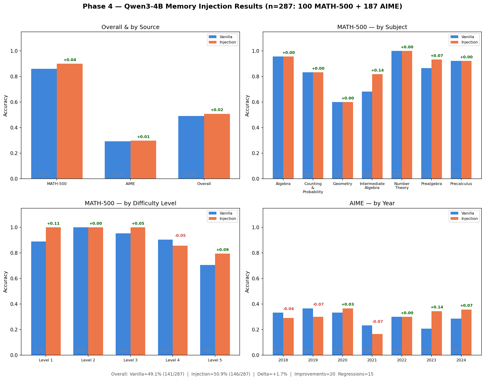

# Phase 4 — Qwen3-4B Results

## Overview

Earlier phases built a pipeline that retrieves a relevant reasoning strategy
from a bank (distilled from a larger teacher model) and injects it into a
student model's prompt before it solves a problem — no fine-tuning, just a
different prompt. That pipeline was validated on a 1.7B student. Phase 4 asks
a follow-up question: **does the same trick still help once the student
itself is bigger and already fairly capable?**

This document covers the run against **Qwen3-4B**.

## How the Injection Technique Works

**Step 1 — build the strategy bank (done once, offline):**

```
 Teacher model  --solves-->  Training problems (MATH-500 + AIME)
       |
       v
 Strategy + worked example, per problem
       |
       v
 Searchable bank  (+ individual steps linked into a graph)
```

**Step 2 — per test problem, at evaluation time:**

```
 New problem
     |
     v
 Embed it, find the closest match in the bank ("anchor")
     |
     v
 Close enough?  --no-->  Skip injection, run plain
     |
    yes
     v
 Take all of the anchor's own steps + its worked example
 (+ maybe 1 bonus step, but only from the anchor's
    immediate neighbours in the graph — see below)
     |
     v
 Add to prompt: "Strategy: ... / Reference Example: ... / Problem: ..."
     |
     v
 Student model answers
```

Every test problem is run **twice** on the identical model — once plain
("vanilla") and once with the strategy added ("injection") — so the only
difference between the two runs is what's in the prompt. The model's weights
are never touched in either case.

### The exact numbers

| Question | Answer |
|---|---|
| What similarity metric is used? | **Cosine similarity.** Problems are embedded with `nomic-embed-text-v1`, vectors are length-normalized, so a plain dot product between two vectors already *is* their cosine similarity |
| How many problems are searched to find a match? | The whole bank — 400 MATH-500 + 746 AIME training problems |
| How many neighbours are retrieved? | Just **1** — the single closest match by cosine similarity ("top-1"), not top-k |
| From how many source problems are steps taken? | Mostly **1** (the anchor). Occasionally **2**, if one extra step is pulled in from a different problem |
| How many steps come from the anchor? | **All** of that anchor's steps (typically 3–5) |
| Where does the bonus step come from? | **Not** a fresh top-k search over the whole bank. The graph already has edges connecting steps that were similar when it was built offline. The bonus candidates are only the steps directly connected to the anchor's own steps by one of those edges — i.e. the anchor's **1-hop graph neighbours**, nothing further out |
| How many bonus candidates are considered? | However many 1-hop neighbours the anchor's steps happen to have (varies per problem) — from that pool, at most **1** is actually kept |
| How is the 1 bonus step picked? | Candidates that are near-duplicates of a step already included are dropped first (novelty check below); of what's left, the one most similar to the **new test problem** (not to the anchor) is chosen |
| How is "near-duplicate" decided? | Also cosine similarity, but rescaled from [-1, 1] to a [0, 1] scale — a candidate step is rejected if it scores 0.85 or higher against any step already picked |
| What if the best match is still weak? | The raw cosine score is compared against a per-subject cutoff (e.g. 0.60 for Intermediate Algebra, 0.50 for most subjects); below that, nothing is injected and the problem runs vanilla-only |

## Experiment Setup

| | |
|---|---|
| Student model | Qwen3-4B |
| Test set | 287 held-out problems — 100 from MATH-500, 187 from AIME |
| Token budget | Up to 16,384 tokens for vanilla, 8,192 for the injected run |

## Results

| | Vanilla | Injection | Change |
|---|---|---|---|
| **Overall accuracy** (287) | 49.1% (141 correct) | 50.9% (146 correct) | **+1.7 points** |
| MATH-500 (100) | 86.0% | 90.0% | **+4.0 points** |
| AIME (187) | 29.4% | 30.0% | +0.5 points |
| Avg. tokens used | 6,282 | 6,033 | slightly fewer |
| Avg. time per problem | 118.7s | 114.5s | slightly faster |

Out of 287 problems: **20 improved**, **15 got worse**, the rest stayed the
same. 20 problems had no good match in the strategy bank (similarity below
the cutoff) and were run vanilla-only.

## Visual Breakdown



By difficulty level (MATH-500), the injected strategy helps most at the
extremes — Level 1 (+11 points) and Level 5 (+9 points) — but actually hurts
at Level 4 (−5 points). On AIME, results swing both ways year to year (from
−7 to +14 points), which supports the earlier point that the AIME effect is
mostly noise rather than a consistent gain.

## Takeaway

The injected strategy still helps Qwen3-4B, but by a much smaller margin
than it did for the original 1.7B student. Almost all of the gain comes from
MATH-500 (+4.0 points); on the much harder AIME problems the effect is close
to a wash (+0.5 points, with roughly as many problems getting worse as
getting better). This fits the broader pattern seen across phases: the
bigger and more capable the student already is, the less a retrieved
strategy has left to add.
